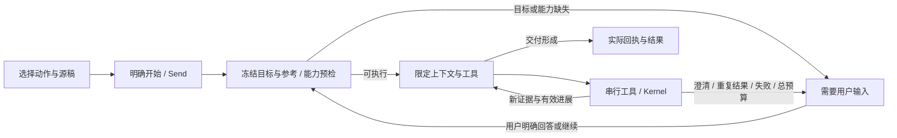

# 文章任务与智能体执行整改

日期：2026-10-27。本文记录本轮实现及验证边界，补充并修正 [写作集成说明](WRITING-INTEGRATION-AND-UPDATES-2026-10-26.md)。

## 根因与取舍

| 问题 | 原实现中的原因 | 本轮实现 |
|---|---|---|
| 点击类型立即跳 AI | 类型按钮直接 send，目标/用途/结果模式不可见 | 类型选择只展示任务设置；明确文章、要求、结果后点击开始 |
| 当前文章丢失 | Desktop 异步保存后重取 selection；Obsidian 打开侧栏后再捕获 focus | Send 时冻结文章身份；重试/恢复沿用；写作入口传结构化目标 |
| 读完方法论还在全局找稿 | 单篇任务仍使用全量技能目录、工作区发现与通用目标协议 | 专用文章提示词只含目标、明确参考、所选技能、实际工具 |
| 成功遍历也能循环 | 原熔断只统计失败；步数耗尽可重获续跑预算 | 模型/工具总预算跨重试与续跑保留；重复结果、失败、无交付探索均停止 |
| 模型说完成但文件没改 | PLAN/DONE 和模型评审混同实际交付 | 单篇任务不使用模型目标续跑协议；真实写入回执决定是否修改原稿 |
| 生图能力混淆 | 视觉模型、图片路径、生图与 PNG 渲染未分开 | 任务预检按实际宿主能力阻止不支持的请求，明确提示词/HTML 替代范围 |

工作区级任务继续使用既有目标台账，但受同一轮总预算和执行守卫约束。设置中的最大步数是上限，不是必须花掉的配额。没有新增内容数据库或平行真源。

## 入口与操作

Desktop：文章格式工具栏的「写作」先保存当前稿，再打开「写作与交付」；应用菜单和原命令仍可用。弹窗源稿保持稳定，不随后台切换标签改变。选动作后展示用途、可选要求、仅给建议/修改指定文章及明确开始按钮。公众号/X/文本的预览、复制、导出独立于 AI，不需先发消息。

Obsidian：「写作与交付」Ribbon、工作台工具栏、AI 侧栏文章上下文条、文件/编辑器右键和命令 `topmind-stream:writing-delivery` 均可进入。源稿用原生模糊选择器选择。打开侧栏前捕获的文章作为结构化参数传入，不重新猜测目标。

封面、长图入口显示当前宿主的实际范围，只准备提示词/HTML 方案；不提供“修改原稿”的结果选项。本文不宣称这两个入口能生成图片。

## 一轮任务的契约

`lib/agent-task-contract.mjs` 为两端共享真源；Desktop 经 `sync:agent-contract` 生成本地快照，Obsidian 经 `ensure-engine` 提交 Kernel 快照。

契约包含原始要求、目标类型与路径、参考路径、技能、结果模式、联网范围和宿主能力。文件目标与参考不互换；用户显式提供的内联原文可成为文本目标，不授权磁盘写入。单篇任务默认不列目录、不扫描全局、不联网；明确外部核查时才开放检索工具。工作区中的文章、参考和工具结果均不能扩大任务权限。

Desktop 在异步保存前冻结消息目标；用户消息展示绑定路径，重试与暂停恢复沿用该身份。Obsidian 将最后文章视图与侧栏焦点分开，读取编辑器的最新缓冲状态；进入非文章主视图会清除旧文章绑定。两端发现未保存目标时要求先保存；执行期间磁盘稿件变化时中止旧写入。原有 Kernel 路径围栏、保护级别与写回机制继续生效。

原生工具 schema 在 SDK 参数验证之前绑定默认文章路径；缺省路径可安全指向目标，但明确传入其他路径仍受范围核对。Desktop 工具串行执行，同一批中的澄清/取消/停止会拦住后续排队操作。不同用户轮次使用不同写入任务 id；自动续跑不改变当前轮的 id。

## 执行与停止

单篇任务每轮工具调用最多 16 次，并受用户配置的更低上限约束；工作区任务另有总预算。模型调用另设上限，防止没有有效工具执行时空转。相同工具、参数和结果出现三次、连续三次失败、连续探索无交付或预算用尽时停止；改变工具名或开始自动续跑都不能清空本轮预算。时间预算在调用边界复查，既有网络超时、流中断与取消机制保留。

`request_clarification` 是实际注册的只读工具，返回问题与可选答案并停止本轮。待澄清契约保存在既有会话检查点中；回答可重新绑定原目标，不能因为焦点换到另一篇而静默换稿。明确的新任务/新会话不继承旧约束。任务完成后不追加自造的验收项，也不为单篇改稿再发一次模型评审。

仅给建议的任务在执行层拒绝写入。修改模式没有真实写入回执时显示“原稿尚未修改”；模型输出 DONE 不能冒充写入成功。停止保留已经完成的修改，不擅自回滚或再次执行。

运行时已开始执行后不切换另一套循环重放任务；已经发生写入时也不因上下文溢出自动重放旧消息。后续记忆提炼的修改候选来自工具实际写入，不把模型在正文里引用的路径当作修改证据。

## 能力与验证边界

两端当前聊天路径未接入真实图像输入、生图和 PNG 渲染工具。二进制附件不当作 UTF-8 正文注入；模型元数据中的视觉支持不意味着图片已经送入模型。未知能力不提升为已支持，提示词/HTML 不冒充成图。

新增回归直接调用共享守卫、Desktop AiService → Pi → AI SDK → 工具 → Kernel，以及 Obsidian 实际聊天执行器。服务商响应完全离线替换，可强制复现重复读取、越界操作、虚假完成和同批澄清后写入；原生外壳使用仓库测试替身，文件读写与状态机实际执行。前端验证使用真实组件与 fixture RPC，覆盖选择不发送、预览零 AI、显式开始、切标签仍绑定原稿和 430px 无横向溢出。

这些检查不能证明所有在线模型的审校质量，也不等价于微信/X 粘贴、真实 Vault 中全部 Obsidian 主题或每个平台安装后的实机验收。发行时分别报告本地门禁、远端构建和实际交互验证。

设计参考：[Anthropic：Building effective agents](https://www.anthropic.com/research/building-effective-agents)、[AI SDK：Loop Control](https://ai-sdk.dev/docs/agents/loop-control)。采纳的是明确目标、渐进工具、环境反馈、外部停止条件和人类澄清；具体预算与状态转换由本项目实现和测试约束。
