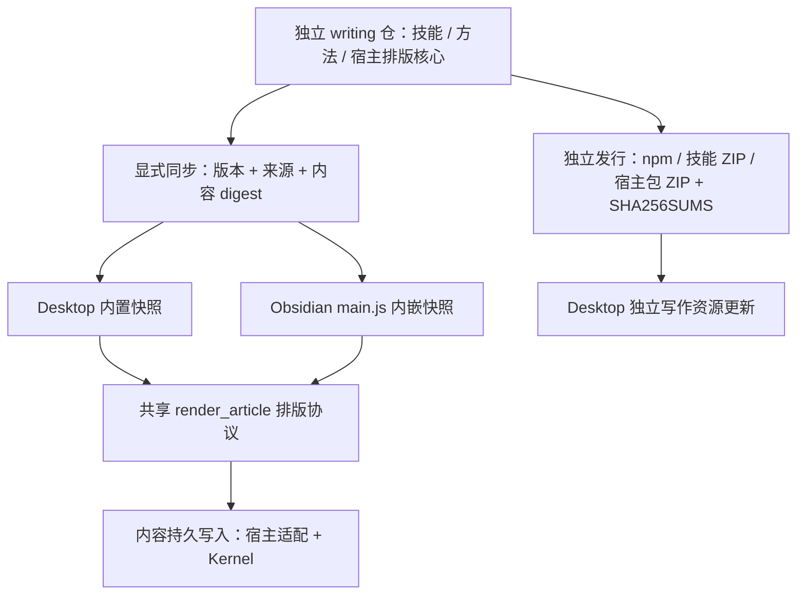

# 独立写作包集成与安装升级整改

日期：2026-10-26。本文描述本轮实现与验证边界；具体版本以各仓 manifest、package.json 和提交的快照为准。

## 仓库与发布边界

`topmind-writing-skills` 始终是独立仓库、独立 npm 包、独立技能与独立发行节奏。Desktop 和 Obsidian 内置受验证的版本快照并使用它，不收编写作仓，也不要求它跟随宿主升号。核心 `topmind-skills` 负责工作区语义与通用路由，不复制写作规则。

写作仓的 `lib/host-pack.cjs` 生成按包隔离的资源与清单，`runtime/article-renderer.mjs` 是两端宿主排版的唯一源码。Python 高级脚本继续服务独立 Agent 场景；宿主排版支持范围明确，扩展容器和图表等不会被无声当作完整支持。

## 默认内置与能力发现

- Desktop 的 `scripts/sync-writing-pack.mjs` 显式生成 `electron/data/writing-pack.json`、Electron/前端排版快照；`npm run check:writing` 检查来源一致性。正常构建使用提交内容，不拉取写作仓 HEAD。
- Obsidian 的 `scripts/sync-skills.mjs` 同步 core 与 writing 两份快照、排版模块。正常 build 使用提交内容；正式三文件安装也能发现全部写作技能，不依赖 Desktop 或姊妹仓。
- 两端默认提供改稿、只排版、短文、互动短帖、公众号、X 长文、封面与长图。发现仅给元信息，正文与参考按需读取。
- 激活资源按包身份解析。Desktop 的 bundled、受管版本与用户明确提供的额外来源保持可见优先级；Obsidian 不把两个包的同名 shared 资源合并。
- 内置 `render_article` 从真实 Markdown 生成公众号/X/文本，返回 HTML、文本、图片清单与诊断，无文件写入和发布副作用。需要持久交付时使用已有写入工具。
- 宿主技能激活附带能力说明；脚本文本可读不等于 shell 可执行。生图、外部检索、PNG、平台发布仍依赖真实工具，缺失时必须说明。

## 功能布局与入口

Desktop 保持主导航、文件树和主编辑器。写作入口位于应用、状态栏和命令面板；原插件 `topmind-wechat` 与公开命令 id 保留兼容，显示为“写作与交付”。界面依次为八个动作、源稿、格式与主题、预览/复制/导出、诊断与图片清单。窄屏控件折叠、动作换行，不新增八个应用。

Obsidian 使用命令面板和笔记菜单打开原生写作弹窗；动作进入既有 AI 副驾，排版使用同源核心。保留原生编辑器、文件树、Markdown 与 Vault 事件，不移植 React 壳。

源稿继续使用现有目录和文件名，`公众号稿.md` 可原位打开。导出位于源稿旁 `out/<源稿名>-<格式>.html|txt`；有图片时附带图片交付清单。它们是派生交付，不替代源稿，也不创建工作区根 `writing/` 或第二套内容数据库。

预览与复制使用同一产物；未保存源稿、源稿变化、图片变化需要先保存或重新生成。主题/格式切换使预览失效。HTML 在禁止脚本的 iframe 中展示，原始 HTML 转义，危险 URL 不可执行，本地图读取经过宿主 realpath 围栏。内嵌图片不代表微信/X 已托管，最终粘贴仍需目标平台核对。

中英文入口与动作保持一致，动作跟随界面语言且保留源稿语言。没有“AI 味综合评分”“定稿分数”或自动发布成功假象；事实、归因和作者意图由内容审校负责。

## 已清理的旧实现

- 删除独立公众号包列表、内嵌编辑器、评分/质检流水线；统一到当前文档和既有 AI 会话。
- 删除 `src/lib/wechat-quality.ts`、`src/lib/wechat-format.ts` 与 `electron/wechat-service.mjs`，移除 Python 探测与脚本旁路 RPC。
- 删除旧界面源码字面量测试，增加调用真实模块的排版、加载、安装、更新与写回行为回归。
- 清理失效公众号实验设计说明与索引，更新历史引用到本文。
- 保留用户文章、旧输出、主题、禁用状态、设置及公开插件/命令身份；旧 packageRoot 设置不再决定新流程的默认路径，但不主动删除用户值。

## 组件安装与升级

### 官方资源包

写作仓独立发行宿主包 ZIP、SHA256SUMS 和 latest.json。构建器只打包 allowlist 文本资源，不把示例大图或开发状态无差别内嵌；ZIP 使用固定时间戳与顺序，可复现且不依赖系统 zip 命令。

Desktop 受管布局为 `<既有管理区>/skills-extra/packs/<包名>/versions/<版本>-<摘要>/`，`active.json` 记录实际激活版本。完整复制和验证后才切换记录；安装回执属于该版本，shared 与其他包隔离。旧版本文件保持不变，运行中的工具回合钉住其解析来源，后续回合使用新版本。

安装包含版本核对、资源摘要、路径围栏、组件锁和本地定制检测。失败不切换激活记录；死亡进程的安装锁可恢复。旧版本与文件保留用于恢复，“恢复内置写作版本”仅切回 bundled，不删除文章或其他包。旧平铺 extra roots 继续读取，旧设置里指向受管版本的路径不能永久压住新的激活记录。

主界面分别呈现 Desktop、核心技能、写作包、Clip、Obsidian 的更新。核心版本比较使用本 Desktop 的实际受管版本，不再使用无关 Agent 宿主安装版本的最高值。

### 下载完整性

官方组件有 GitHub asset digest 时直接核验；ZIP 无 digest 时必须取得 SHA256SUMS 并匹配精确文件名。缺摘要、错误摘要、格式错误校验行、错误版本和非本次 Release 的 URL 都会失败。Obsidian 三文件按 GitHub 原生资产 digest 核验，保持插件发行只有标准安装资产。

SHA256 是完整性检查，不等同于平台代码签名。下载来自明确 Release 与 HTTPS，宿主可执行代码仍按自身发行与权限边界处理。不会因为安装技能自动执行下载的 JS/Python，renderer 代码升级随宿主发布。

### Desktop 本体

使用 electron-updater 的检查、下载、就绪和显式重启状态；不把“打开链接”或“下载完成”标记成正在运行的版本已升级。安装提示只针对本应用，保留手动下载与既有安装器交接。

发布配置提供 GitHub feed，上传平台 latest*.yml 和 blockmap。macOS 只有检测到正式签名时显示自动升级；Linux 自动升级限 AppImage，其他渠道使用相应手动/包管理器路径。开发模式不触发网络升级，更新器错误使用可公开的错误分类。

本轮检查到仓库未配置平台签名凭据，因此不能宣称未签名 macOS 安装包已支持自动安装；保留手动升级是当前真实能力。Windows 签名与 macOS 公证也需要发行者配置相应凭据，不能通过代码生成。

### Obsidian 与外部 Agent

Obsidian 代码与内嵌资源通过标准插件 Release 升级，保持 id `topmind-stream`，tag 等于 manifest.version，无 v 前缀；不在插件内部下载执行新代码。Desktop 手动安装仍只针对用户明确选择的 Vault，保留插件状态和已有文章。

Desktop 4.17.1 起，安装前读取本地 `data.json` 并逐字节带入暂存版本，不导入发布包中的设置；升级不改变已有插件启用状态。复制期间或切换前发现设置变化会中止替换并保留新设置，应关闭 Obsidian 后重试。4.17.0 远端安装冒烟暴露了旧安装器丢失设置的问题，已改为预发布，稳定使用要求 4.17.1 或更新版本。

独立写作 CLI 保持原命令、作用域与版本比较；安装改为先复制完整临时目录再切换，失败恢复旧技能。核心技能 installer 继续支持独立外部包，路由说明明确“独立包”与“宿主未安装”的区别。

## 维护与发布

写作改动先在写作仓完成并发布，再显式刷新两端快照，提交内容版本与 digest。核心工具 schema 在主仓维护，通过 sync-agent-contract 与 Obsidian ensure-engine 同步；不手改 vendored 副本。具体发布顺序与命令见 [维护手册](REPO-MAINTENANCE.md)。

当前四仓版本相互独立，只对实际修改的仓库升号。变更记录分别维护；写作仓各技能仍只为自身实质改动升号。

## 验证范围

- 原有 Desktop 完整质量门已在改动前通过；沙箱限制 tsx IPC 时在授权环境重跑，不跳过测试。
- 写作仓覆盖包快照、格式、链接、原始 HTML、图片协议、特殊路径与安装 CLI，沿用全部技能负向测试及 shared/隐私/打包门禁。
- Desktop 覆盖默认内置、按来源加载、独立版本发现、受管安装失败/定制保护、下载校验和更新器状态。
- Desktop Obsidian 安装回归覆盖设置原始字节、包内设置隔离、禁用状态和复制中并发修改；远端 4.21.0 正式三文件在临时 Vault 完成摘要核验与设置保留冒烟，不触碰用户真实 Vault。
- Obsidian 覆盖三文件独立技能发现、真实 Kernel 导出、旧稿保留、源稿过期、源稿/图片 symlink 越界拒绝，并运行类型、lint、完整测试和可复现构建。
- 浏览器以真实 Desktop 写作组件和 fixture RPC 验证宽屏、430px 窄屏、八个动作、排版预览与横向溢出；这不等价于 Electron 安装器或微信/X 的最终粘贴验收。
- 平台安装、签名、公证、真实用户模型产出及目标平台粘贴须在相应环境核验。发布记录必须区分本地质量门、远端构建与实机验收，不把它们混称“全部已测”。
