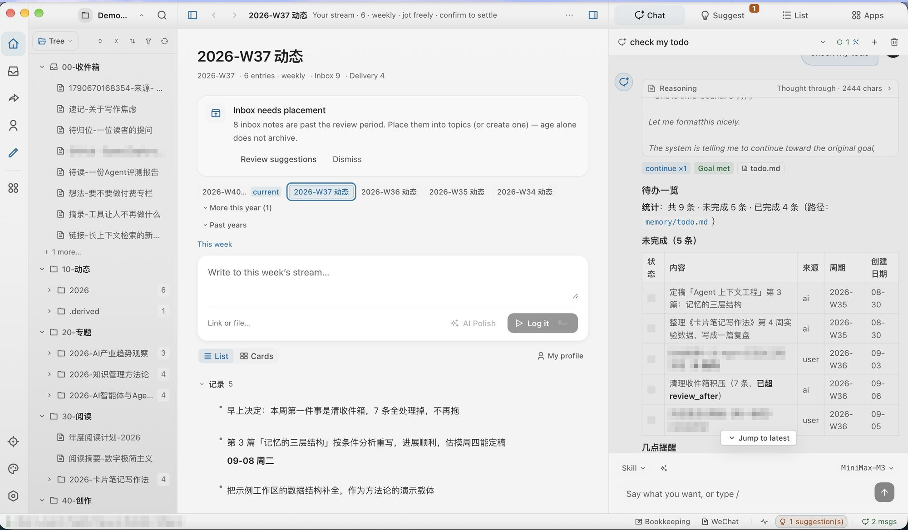
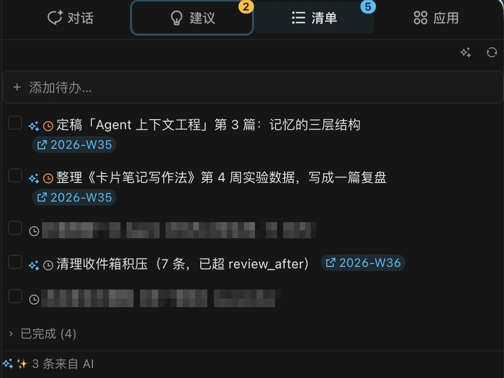
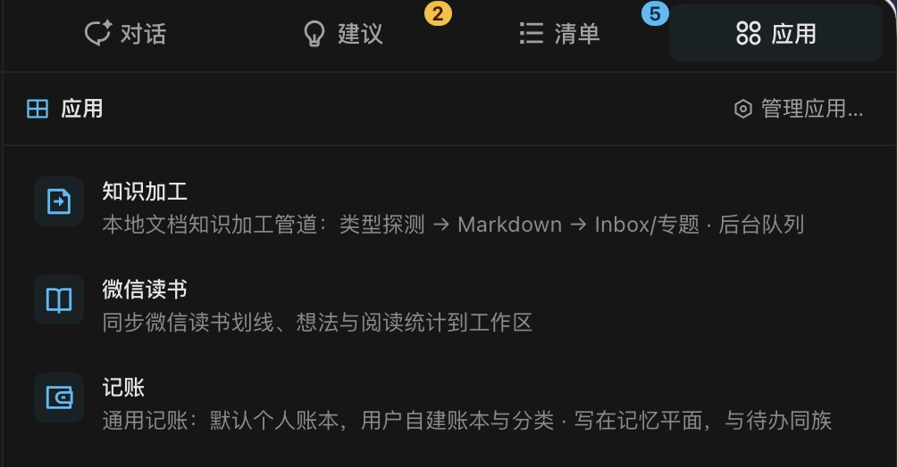

# topmind Desktop

[简体中文](README.md) · [English](README.en.md)

> Local-first **rich workbench** — personal stream · deep editing · AI copilot · reversible writes.  
> **Version truth:** this directory’s [`package.json`](./package.json) (`npm run versions`).  
> **Content truth:** always the **workspace folder**. Desktop does not hard-depend on UTR.  
> User concepts ≤ 5: **Note it · Stream · Topic · My profile · Delivery**  
> Workflow: `收进来 -> 继续做 -> 交付/沉淀 -> 找回/调整`

[Product overview](../README.en.md) · [简体中文总览](../README.md) · IA / pixels: [`DESIGN.md`](./DESIGN.md) · Architecture: [`ARCHITECTURE.md`](./ARCHITECTURE.md) · Implementation lock: [`../docs/ARCHITECTURE-RESET.md`](../docs/ARCHITECTURE-RESET.md)

---

## Why Desktop

| Friction | Path |
|----------|------|
| No time to classify an idea | `⌘N` / `⌘⇧N` → this week’s **stream** |
| Office / PDF files scattered | Drop into the **ingest** queue |
| Polishing means switching to a chat app | **Inline AI** + sidebar Agent (output is sanitized) |
| Switching tools loses format | Plain Markdown · files stay portable |

1. **Stream-first navigation** — concepts stay few; Inbox / Delivery / My profile stay reachable  
2. **Quiet Paper** — type size / leading / measure / paper · focus `⌘⌥F`  
3. **AI copilot** — skill-first · `auto | confirm` save settings · suggestions generate by default and run after you confirm; multi-lane AI keeps prep serial and chat independent (see `DESIGN.md` §0.0.3)  
4. **Multi-source ingest** — default anydoc (Word · PDF · Excel · PPT · ODF · RTF · EPUB · CSV) + built-in mail/HTML → Markdown; optional markitdown / pandoc  
5. **Composable** — shares content conventions with Skills / Clip / optional UTR; no mandatory runtime binding. WeRead connector uses the official Agent Gateway; incremental skip by count and note fingerprint; books with no highlights/thoughts are not written as topics.  
6. **Capture vocabulary** — **Note it** (full capture · 记一下) ≠ **Log it** (stream composer · 记下)  
7. **Localized AI** — suggestion / todo / op chrome follows host UI language; Agent and inline rewrite follow explicit request → source script → workspace locale (`lib/ai-output-locale.mjs`)  
8. **About & updates / Extensions & integrations** — detects agent hosts · browser · Obsidian; installs / upgrades / uninstalls Skills, Clip, and the plugin (browser side is guided load-unpacked, never silent inject); unified update check and health diagnosis
9. **Optional bookkeeping** — enable-gated mini-app (`memory/ledgers/`; AI workspace Apps pane / StatusBar / ⌘K). Not a 6th user concept or PrimaryNav item.
10. **Native OS chrome** — Windows owns a **full-width OS strip above the three columns** (app mark / name / menu labels); the OS still draws minimize-maximize-close over that strip's right end. Product column headers never take OS chrome. Linux keeps its native frame and menu bar; macOS gets the complete system menu. Menu items emit the same command ids as the keyboard, and the strip pops the real native submenus by id — no behavior and no menu content is implemented twice. Chrome policy: `electron/lib/window-shell.mjs`

---

## Interface tour and demo

Screenshots are compressed for docs (full-resolution sources live in `resources/img/` on the development machine only — the directory is gitignored; the shared library is [`../docs/images/`](../docs/images/README.md)). The stills below are the **2026-09 three-column chrome · ZCode Neutral + MD3 warm-paper theme** (Chinese and English UI).

### 1. Core workbench (stream timeline + AI workspace)

Default three columns: **nav → Stream workbench home → AI workspace**. Home is identity, quiet Inbox/Delivery inventory counts (not a second row of destinations), the hero Log it composer, and the period feed. An empty workspace keeps that structure and says it is empty. The status bar is status only (full path · AI · busy), not Stream / Inbox / Delivery. The right column holds **Chat · Suggest · List · Apps**.

<p align="center">
  
</p>

### 2. AI workspace panes

**Suggest** collects proposals and pending writes; **List** is the todo list (`memory/todo.md`, with AI provenance marked); **Apps** is the enable-gated mini-app launcher (ingest · WeRead · bookkeeping).

<p align="center">
  
  
</p>

### 3. Interaction map

> Chords below are written in macOS glyph form (`⌘`). Inside the app on Windows / Linux they **render** as `Ctrl` chords (`Ctrl+Shift+N`) — a shortcut is declared once and labelled per platform.

| Entry | Single job |
|-------|------------|
| ActivityBar **Note it** `⌘N` | The **only** full capture (note / link / attachment) |
| Global float `⌘⇧N` | Capture from anywhere; submits to the capture queue |
| Stream **Log it** | Append the composer to this week’s period note |
| Stream **AI polish** | Inline clean/polish; edits the composer only · does not write disk |
| Stream / sidebar **AI todos** | Extract todos · detect done · confirm updates |
| AI workspace **建议** pane | Suggestions + pending writes; Kernel write gate runs after confirm |
| Sidebar **My profile** | Memory-plane browse (profile / periodic / topic memory); opening a row still lands on the file |
| **Ingest hub** | Default anydoc → Markdown (Word / PPT / Excel / ODF / RTF / EPUB / PDF / CSV); optional markitdown / pandoc; mail uses the built-in path |

- **Reading Aa**: size / leading / family / measure / margins / paper (edit and preview share the same chrome; preview is a static HTML snapshot, not live TipTap)  
- **Files**: `.md` opens in the Markdown editor (primary canvas and split pane; Obsidian image embeds and note-relative images render in edit and preview). png / jpeg / gif / webp open inside `FilePreviewView`; svg and other text stay text; HTML is sandboxed; other binaries open externally  
- **Inline AI / stream polish**: `ai.complete` (`action: "polish"` and siblings) · sanitize before display  
- **Agent**: `load_skill` · save settings auto/confirm · AI workspace 建议 pane (suggestions + pending writes)  
- **Todos**: `memory/todo.md` · write gate · AI maintain (extract / detect done / force)  
- Focus `⌘⌥F` · multi-tab / single-tab  

---

## Mental model

```text
收进来 -> 继续做 -> 交付/沉淀 -> 找回/调整
```

```text
~/topmind/
├── topmind-workspace/     # content truth (user data)
└── topmind-desktop/       # runtime (state / plugins / logs)
```

- Categories + topics: [`../PROJECT-MODEL.md`](../PROJECT-MODEL.md)  
- AI skill-first: engine `skills/` + optional `skills-extra/`  
- AI providers: OpenAI · Anthropic · Google · xAI · DeepSeek · Moonshot · Zhipu · MiniMax · Ollama (local) · Custom; official list-models + models.dev catalog + curated fallback  
- Four-core boundaries: [`../PRODUCT-BOUNDARIES.md`](../PRODUCT-BOUNDARIES.md)  

---

## i18n and localized AI

- UI default `auto`: match OS / `navigator.language` to `zh-CN` or `en-US`  
- Main window and the `CaptureSurface` float stay in sync; packs live in `src/locales/{zh-CN,en-US}/`  
- **Workspace locale** (`topmind.yaml` `locale` / `workspace.locale`) is the last-resort language when the host UI is `auto`  
- **Document AI** (inline rewrite / Agent writing into a note): explicit request → source document → workspace locale. UI does not rewrite a Chinese note into English.  
- **Product AI** (suggestion cards, todo extract/maintain, memory organize): explicit request → Desktop UI locale (if not `auto`) → workspace locale. Obsidian uses its plugin / app language the same way.  
- Content resolution: `lib/ai-output-locale.mjs` (`resolveOutputLanguage` vs `resolveProductAiLanguage`)

---

## Install / upgrade / manage

### Install Desktop

#### Option 1: Homebrew (recommended on macOS)
```bash
brew install topmindspace/tap/topmind
```
Homebrew clears macOS `quarantine` so unsigned builds do not show as “damaged”.

#### Option 2: Manual installer
1. Download the installer whose **file name** carries the version from [Releases](https://github.com/topmindspace/topmind/releases). A product or skills `v*` tag is not itself the Desktop version. Windows x64 is `topmind-<ver>-win-x64.exe`; Windows ARM is `topmind-<ver>-win-arm64.exe`. Do not mix those two. macOS and Linux use `topmind-<ver>-<os>-<arch>` the same way. `desktop-v*` is only a hotfix tag; the version still comes from the installer file name.
   For macOS Homebrew: `brew install topmindspace/tap/topmind` (auto-clears quarantine).  
   If `brew upgrade --cask topmind --greedy` fails with `App source '/Applications/topmind.app' is not there` (previous app moved/deleted):
   ```bash
   brew uninstall --cask topmind --force && brew install --cask topmind
   # or
   brew reinstall --cask topmind
   ```
2. Install and open. With no workspace, a full-screen picker explains why (none selected, closed, could not open, the engine could not start, or an unrepairable contract). Recents show the full path and whether they are usable, and can be opened or removed from the list. Creating a workspace happens only after you pick a folder and confirm a template. The app never auto-creates a workspace to fill the window. The folder is the content source.  
   If macOS reports a damaged app after a manual install:  
   `sudo xattr -rd com.apple.quarantine /Applications/topmind.app`
3. Optional: Settings → AI to configure a provider; Settings → General → Browser clip to enable Clip Bridge.

### Settings → About & updates / Extensions & integrations
| Capability | Behavior |
|------------|----------|
| **Agent Skills** | Detects Claude Code / Codex / Hermes / OpenCode / CodeBuddy; installs into the host global skills root; standalone installer in [topmind-skills](https://github.com/topmindspace/topmind-skills) and community `npx skills add topmindspace/topmind-skills` still work |
| **Clip extension** | Unpacks to a hosted folder + guides “Load unpacked” — **cannot** silently write Chrome; uninstall cleans the hosted folder |
| **Obsidian plugin** | Community store (in review) / BRAT / direct install into `plugins/topmind-stream/` |
| **Standalone paths** | topmind-skills installer / community `npx skills` / pack zip remain valid and do not conflict with Desktop |
| **Where the package comes from** | Skills resolve from `topmindspace/topmind-skills` (`topmind-skills-<ver>.zip`, or the published `.tar.gz` when the zip is absent). Obsidian resolves from `topmindspace/topmind-obsidian`: a zip when one is published, otherwise the community files `main.js`, `manifest.json`, and `styles.css` — it does not invent a zip that would 404. Clip and Desktop resolve from `topmindspace/topmind` |
| **A failed download is not an upgrade** | A 404, a hash mismatch, or a failed unpack/copy does not report success and does not claim the latest was installed. A bundled copy is labeled as a fallback, not as the latest install. If Obsidian or a skills host has the files open, Desktop asks you to close that app and retry; it does not kill that process and does not remove the existing install |
| **Desktop installer** | If topmind is already running, Desktop asks first. Confirm quits only this topmind process and then opens the installer. Cancel leaves the app running and does not report an update. Obsidian, agent hosts, and other `electron.exe` processes stay up |

Onboarding after the first workspace open can offer optional modules; it does not block the main path.

### Upgrade
| Method | What to do |
|--------|------------|
| Homebrew | `brew upgrade --cask topmind --greedy` |
| In-app check | About & updates / Extensions & integrations → **Check for updates** (Desktop / Skills / Clip / Obsidian; reads public `latest.json`, no GitHub token) |
| Inline upgrade | About & updates / Extensions & integrations → download for Skills / Clip / Obsidian. Success is only when the resolved package is actually written into the receipt or `manifest.json` |
| Already running | Desktop asks before its own installer. Confirm quits only this topmind; cancel leaves it running |
| Module upgrade | Settings → About & updates / Extensions & integrations → upgrade per host / plugin |
| Manual installer | Install the newer package over the old one; workspace folder and `app-settings.json` are kept |
| From source | `git pull` → `npm run desktop:dev`; version truth is this directory’s `package.json` |

Workspace Markdown / `topmind.yaml` / `memory/` are **not** overwritten by a Desktop upgrade. Skills, UTR, the clip extension, and the Obsidian plugin can ship inside the Desktop engine (`resources/topmind-engine/`). Surfaces version independently. An inline upgrade replaces files only after download, hash check, and unpack all succeed; a failure leaves the previous tree in place. See [`../docs/PACKAGING.md`](../docs/PACKAGING.md).

---

## Develop

```bash
# this directory
npm run dev
npm run check:quality    # full quality gate

# repo root
npm run desktop:dev
npm run desktop:quality
npm run desktop:pack:mac # or :linux / :win
```

| Document | Role |
|----------|------|
| [`DESIGN.md`](./DESIGN.md) | Product interaction · inline AI adversarial cases |
| [`ARCHITECTURE.md`](./ARCHITECTURE.md) | RPC · services · AI pipeline |
| [`PLUGIN.md`](./PLUGIN.md) | Plugin slots |
| [`../docs/PACKAGING.md`](../docs/PACKAGING.md) | Pack naming and installers |

Back to overview: [`../README.md`](../README.md)
